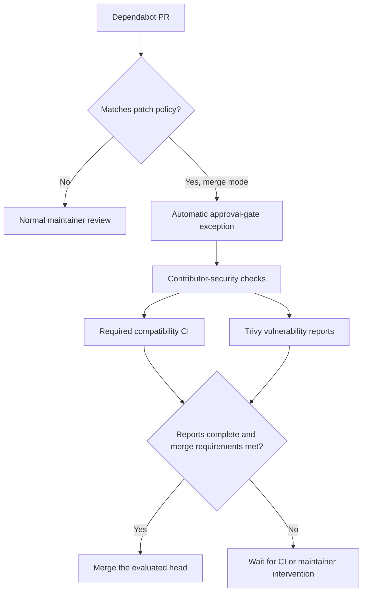

# Dependabot auto-merge pilot

The pilot starts in **report mode**. It lists which open Dependabot PRs match
the policy without approving, labeling, or merging them. The GitHub Actions
variable `DEPENDABOT_AUTOMERGE_MODE` controls the rollout:

| Value | Behavior |
| --- | --- |
| Unset or `report` | Report candidates; retain existing approval and scan behavior. |
| `merge` | Eligible PRs can pass Maintainer Approval without a human and merge after checks. |

The scheduled **Dependabot Auto-merge** workflow runs every 30 minutes and can
also be dispatched manually. It uses scripts and policy from `main`; PR files
are read through the GitHub API and parsed as data. No PR code is checked out
or executed by the merging workflow.
Read operations use the workflow's read-only token. Merge mode mints a token
for the existing Omnigent GitHub App, restricted to this repository, so the
merge can trigger normal post-merge workflows. Missing App credentials stop
merge mode; there is no fallback to a merge using `GITHUB_TOKEN`.



## Initial scope

The package list and seven-day cooldown live in
[`dependabot-automerge.json`](dependabot-automerge.json). The initial packages
are `coverage`, `pytest`, `pytest-cov`, `pytest-xdist`, and `ruff`. Our existing
CI executes these tools. Development dependencies are not automatically
eligible simply because they are development dependencies.

Every candidate must meet all of these conditions:

- Dependabot opened a non-draft, same-repository PR targeting `main`.
- Only the root `uv.lock` changes. Manifest changes need review.
- Every changed package is on the list and moves forward within the same
  three-part major/minor version. Prereleases and nonstandard version formats
  need review. Unchanged packages with multiple conditional versions are fine;
  changes to those packages need review.
- Package names, dependency edges, sources, and lockfile resolution settings
  remain unchanged. Added or removed packages need review.
- Updated artifact URLs, hashes, and sizes match PyPI. Each locked artifact is
  unyanked and at least seven days old according to PyPI's timestamp.
- No reviewer has an outstanding changes-requested review, and neither
  `hold-automerge` nor `skip-security-scan` is present.

Dependabot places these patch updates in `python-tooling-patches` before the
general Python group. A group qualifies only if every actual lockfile change
qualifies. Runtime dependencies, harnesses, and all other ecosystems retain
normal review. Expanding the pilot requires changing the package list and
Dependabot group together, with evidence that CI exercises the added packages.

## Scans and merge requirements

For an eligible candidate in merge mode, Security Scan retains its secret,
exfiltration, sensitive-path, workflow-misuse, and Semgrep checks. It omits the
old full-lock pip-audit step. This prevents unrelated baseline advisories from
stopping compatibility tests. The broad `skip-security-scan` waiver is not
applied by this automation.

The merge worker separately requires successful Security Scan and both Trivy
checks on the evaluated head. It downloads the repository report from the
latest successful Trivy run for that head and verifies every changed package
appears in its inventory. Missing reports, scanner failures, incomplete
inventory, and malformed results cannot authorize a merge.

High, critical, or unknown-severity findings on a changed package require
human review. Low and medium findings may remain. Findings on unchanged
packages remain visible in the report and do not block the pilot. This rule
controls unattended merging; maintainers can still review an upgrade that
does not qualify.

The worker enforces this advisory policy; a green Security Scan alone does
not certify it. A maintainer merging directly must inspect the Trivy report.
Switching back to report mode does not invalidate existing check results;
rerun Security Scan and Maintainer Approval to restore their normal behavior.

GitHub continues to enforce `Merge Ready` and `Maintainer Approval`. The worker
uses `--match-head-commit` and never uses an admin bypass or queues native
auto-merge for later. It rechecks PR state, labels, reviews, and base/head
before requesting the merge. If required CI is still pending, it retries on
the next scheduled run.

## Validate and enable

1. Land in report mode. Inspect **Actions → Dependabot Auto-merge → Job
   summary** to see matching packages and reasons other PRs need review.
2. Check an eligible patch PR against its diff, release dates, required CI,
   and downloaded Trivy report. Confirm the report contains the changed
   package versions and any relevant advisories.
3. After reviewing that evidence, set repository Actions variable
   `DEPENDABOT_AUTOMERGE_MODE` to `merge`. Existing candidates whose checks ran
   in report mode need their Security Scan and Maintainer Approval workflows
   rerun once; newly opened/synchronized candidates use the current mode.
4. Observe the first eligible PR through actual contributor scans, compatibility
   CI, report inspection, and merge. Confirm a held PR remains open. Local
   simulated-service tests do not establish this hosted behavior.

To stop the pilot, set the variable to `report` and cancel any in-flight
Dependabot Auto-merge run. To hold one PR, apply `hold-automerge` (create that
label if needed). No native auto-merge requests are left queued by this worker.

Local read-only evaluation, using an authenticated GitHub CLI:

```sh
DEPENDABOT_AUTOMERGE_MODE=report python3 .github/scripts/dependabot_automerge.py \
  --repository omnigent-ai/omnigent
```

Use Python 3.12 or newer. Add `--pr-number NUMBER` to inspect one candidate's
structural policy; this form never merges and does not check CI or reports.

Run the focused tests with the repository development environment:

```sh
uv run --no-sync pytest tests/scripts/test_dependabot_automerge.py \
  tests/scripts/test_dependabot_config.py tests/scripts/test_security_gate.py \
  .github/scripts/maintainer_approval_test.py --reruns 0
```
