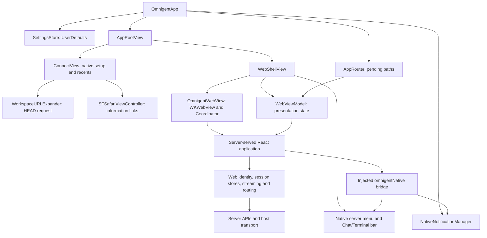

# iOS native shell discovery

Baseline: `76281b9438578e472810879e18fc60acc64d3d6c`, inspected 2026-10-16.
All behavior below is **source-only** unless stated otherwise. No app, simulator,
device, authentication flow, or notification was exercised in this Linux session.
Native build/test execution requires a Mac. The coordinator reports 527 existing
web unit tests passing across 10 files; these validate JavaScript behavior, not
the running iOS app. Native tests were inspected but not run. See
`validation-baseline.md` for the full execution record.

The existing Swift code is useful infrastructure for a mostly native app, but it
does not contain a native session client. Swift owns connection setup and a few
OS integrations; the loaded page owns identity, sessions, chat, decisions, network
recovery, and most navigation. Replacing the main web view therefore requires a
native state/network layer as well as native views. Terminal and HTML rendering
remain optional scope choices.

## Ownership today



Entry points: [OmnigentApp.swift:4](../../web/ios/Omnigent/OmnigentApp.swift#L4),
[AppRootView.swift:19](../../web/ios/Omnigent/AppRootView.swift#L19),
[WebShellView.swift:20](../../web/ios/Omnigent/WebShellView.swift#L20), and
[OmnigentWebView.swift:16](../../web/ios/Omnigent/OmnigentWebView.swift#L16).
`WebViewModel` is a WebKit presentation model, not a conversation model
([WebViewModel.swift:10](../../web/ios/Omnigent/WebViewModel.swift#L10)).

## Native surface inventory and proposed disposition

These dispositions are recommendations for the next implementation plan. “Keep”
preserves a useful workflow, not necessarily the present layout or implementation.
All rows have **source-only** evidence.

| User action and prerequisite | Current result and owner | Evidence / existing coverage | Recommendation |
| --- | --- | --- | --- |
| Launch without a saved server; enter a URL | Native setup with URL keyboard, Connect/loading/error state, touch feedback and system light/dark colors. Normalizes URL, optionally probes a workspace, then opens the page. | [ConnectView:23](../../web/ios/Omnigent/ConnectView.swift#L23), [connect:176](../../web/ios/Omnigent/ConnectView.swift#L176); `ServerURLTests`, setup snapshot UI test | **Keep**, adapting to native connection/auth state and API capability discovery. |
| Launch with a saved server | Automatically loads its URL; Swift does not restore a selected conversation or transcript. | [AppRootView:50](../../web/ios/Omnigent/AppRootView.swift#L50); no launch-restoration test | **Keep/simplify**: restore an explicit server plus selected session when available, then refresh authoritative state. |
| Tap a recent server / switch servers | Setup shows up to five URLs. Floating native menu offers other origins, Reload, and Connect to New Server; loading spinner is WebKit navigation state. | [SettingsStore:37](../../web/ios/Omnigent/SettingsStore.swift#L37), [WebShellView:113](../../web/ios/Omnigent/WebShellView.swift#L113); `SettingsStoreTests` | **Keep** server management; replace page Reload with native reconnect/refresh. Add deliberate disconnect/forget behavior when designing settings. |
| Open Website, Documentation, Privacy Policy from setup | Native menu presents an in-app Safari sheet. | [ConnectView:132](../../web/ios/Omnigent/ConnectView.swift#L132), [SafariView:6](../../web/ios/Omnigent/SafariView.swift#L6); no focused test | **Keep** system browser presentation. It does not make the app's primary UI web-owned. |
| Sign in, sign out, or follow SSO | Page and browser state own the flow. Same-frame HTTP(S) navigation stays in WebKit; there is no native login UI or credentials model. | [navigation policy:404](../../web/ios/Omnigent/OmnigentWebView.swift#L404), [LoginPage:14](../../web/src/pages/LoginPage.tsx#L14), [identity:64](../../web/src/lib/identity.ts#L64); no iOS auth test | **Keep** login, with mode-specific native transport and system browser authentication where supported. |
| Select Chat / Terminal in a suitable session | Native capsule renders web-provided mode/reachability/startup state and sends selection back. Web decides visibility, including keyboard/panel/runner conditions. | [ChatTerminalBar:7](../../web/ios/Omnigent/ChatTerminalBar.swift#L7), [ChatPage:2556](../../web/src/pages/ChatPage.tsx#L2556); no native bar test | **Defer** terminal as a product decision; native conversation UI does not depend on retaining this bar. Reuse styling only if a retained interaction needs it. |
| Swipe inward from the left edge of the web view | UIKit recognizer streams gesture progress to the React sidebar; native web back/forward gestures are disabled. | [OmnigentWebView:34](../../web/ios/Omnigent/OmnigentWebView.swift#L34), [gesture:279](../../web/ios/Omnigent/OmnigentWebView.swift#L279), [AppShell:171](../../web/src/shell/AppShell.tsx#L171); mocked bridge tests | **Simplify** to a native session list/navigation stack and normal native back behavior. No requirement to port this gesture bridge. |
| Edit text / show keyboard / rotate | WebKit fills the safe area and suppresses its input accessory; JavaScript measures `visualViewport` and locks the page to keep inputs visible. Swift and CSS share bar footprints. | [WebShellView:30](../../web/ios/Omnigent/WebShellView.swift#L30), [AccessoryFreeWebView:581](../../web/ios/Omnigent/OmnigentWebView.swift#L581), [useIOSViewportLock:26](../../web/src/hooks/useIOSViewportLock.ts#L26), [useIOSNativeKeyboardInset:6](../../web/src/hooks/useIOSNativeKeyboardInset.ts#L6); focused hook tests | **Keep** usable keyboard/selection behavior; **omit** full-page DOM viewport workarounds in native screens. Verify any retained renderer locally. |
| Open a conversation custom-scheme link | Same origin routes in place; known different origin switches; unknown origin asks native consent before the workspace probe. Only `/c/<id>` is supported. | [AppRootView:147](../../web/ios/Omnigent/AppRootView.swift#L147), [DeepLink:100](../../web/ios/Omnigent/DeepLink.swift#L100); parser unit tests and consent/rejection UI tests | **Keep** and promote to typed, server-scoped native navigation intent. Add approval intent if in scope; omitted-feature links need an explicit browser handoff. |
| Follow HTTP(S), email or app-protocol links from content | New-window web links open through `UIApplication`; same-frame web links can navigate within WKWebView. Email opens directly. Other schemes get Cancel/Open, and Always Allow on the pinned origin; grants are stored per origin. | [OmnigentWebView:404](../../web/ios/Omnigent/OmnigentWebView.swift#L404), [external URL:482](../../web/ios/Omnigent/OmnigentWebView.swift#L482); grant-storage unit test, no navigation delegate test | **Keep/simplify** deliberate external opening under native routing. Retain the permission boundary for custom protocols if they remain supported. |
| Receive session attention notification / badge while page code runs | Web computes unread/attention state and asks Swift to create immediate local notifications or set app badge. Swift asks OS authorization on demand and presents foreground banners, list and sound. | [NativeNotificationManager:23](../../web/ios/Omnigent/NativeNotificationManager.swift#L23), [useIdleNotifications:207](../../web/src/hooks/useIdleNotifications.ts#L207); web notification tests only | **Keep** foreground attention semantics; **defer** APNs/background monitoring unless separately funded. Native state should own badge aggregation and notification policy. |
| Tap a delivered notification | Swift passes `navigatePath` through AppRouter and JS callbacks into React navigation. There is no server identifier in the notification payload. | [NativeNotificationManager:43](../../web/ios/Omnigent/NativeNotificationManager.swift#L43), [WebShellView:72](../../web/ios/Omnigent/WebShellView.swift#L72), [useIdleNotifications:181](../../web/src/hooks/useIdleNotifications.ts#L181); no iOS routing test | **Keep**, adding server/base identity and a pending intent that survives startup/login. |
| Choose photo capture or dictation from web UI | Plists declare camera, microphone and speech purposes. The media-capture delegate grants camera/mic requests only for the pinned origin/current page; OS permission still applies. No Swift capture/dictation service exists. | [Info-Release:38](../../web/ios/Omnigent/Info-Release.plist#L38), [media delegate:449](../../web/ios/Omnigent/OmnigentWebView.swift#L449); privacy-string unit test only | **Defer** dedicated camera/voice features pending scope; ordinary system keyboard dictation can support a native text composer. Retained uploads can use native pickers separately. |
| Encounter navigation failure, blank page or web process termination | Pinned-origin load errors return to setup. A six-second bridge watchdog reveals the server menu if the page never reports liveness. Web process termination reloads the page. | [WebViewModel:27](../../web/ios/Omnigent/WebViewModel.swift#L27), [OmnigentWebView:400](../../web/ios/Omnigent/OmnigentWebView.swift#L400), [failure:523](../../web/ios/Omnigent/OmnigentWebView.swift#L523); no native failure test | **Keep** recovery affordances, rebuilding them around native connection/auth/session states. A renderer crash should not reset native session state. |
| Find in web content / view workspace-hosted content | WebKit find interaction is enabled, but no custom find UI is provided. Workspace paths receive CSS positioning the app over workspace chrome. | [OmnigentWebView:38](../../web/ios/Omnigent/OmnigentWebView.swift#L38), [workspace CSS:551](../../web/ios/Omnigent/OmnigentWebView.swift#L551); no focused tests | **Defer** dedicated transcript search; **omit** workspace page-chrome CSS once native screens call APIs directly. |

The shell is iPhone-only with an iOS 18 minimum in project settings
([project.pbxproj:500](../../web/ios/Omnigent.xcodeproj/project.pbxproj#L500));
portrait and both landscape orientations are declared
([Info-Release.plist:48](../../web/ios/Omnigent/Info-Release.plist#L48)).
Accessibility labels are present for setup, server switching and view mode;
fixed font sizes and control heights remain in these views. VoiceOver, Dynamic
Type, large accessibility sizes, hardware keyboard, and rotation are **unknown**
until tested. Native chrome follows the system appearance while the web app can
store `web-theme`; its theme sync only targets Electron
([ThemeProvider:10](../../web/src/components/theme/ThemeProvider.tsx#L10)).

## Complete iOS bridge contract

The script is injected at document start into the main frame and exposes a frozen
`window.omnigentNative` with `kind: "ios"`
([OmnigentWebView:19](../../web/ios/Omnigent/OmnigentWebView.swift#L19),
[script:81](../../web/ios/Omnigent/OmnigentWebView.swift#L81)). Swift accepts inbound
messages only from the pinned server origin, with that origin still displayed,
and only from the main frame
([trust check:475](../../web/ios/Omnigent/OmnigentWebView.swift#L475)).
There is no bridge version negotiation or native API request transport.

| Operation | Direction, data and semantics | Swift / web evidence | Native rewrite disposition |
| --- | --- | --- | --- |
| `kind` | Read-only discriminator used to detect iOS layout/features. | [script:185](../../web/ios/Omnigent/OmnigentWebView.swift#L185), [nativeBridge:52](../../web/src/lib/nativeBridge.ts#L52) | **Omit** from native screens; a renderer may need its own limited capability contract. |
| `setBadgeCount(count)` | JS → Swift, finite number fallback to zero; Swift converts to integer, clamps below zero, requests permission, sets app badge. Android activation metadata is ignored. | [script:187](../../web/ios/Omnigent/OmnigentWebView.swift#L187), [receiver:338](../../web/ios/Omnigent/OmnigentWebView.swift#L338) | **Keep** native service; replace web caller with attention state. |
| `notify({title, body, navigatePath})` | JS → Swift; requires nonempty title; immediate local notification. JS returns `Promise.resolve(true)` before permission/scheduling completes, so the result is not delivery evidence. | [script:193](../../web/ios/Omnigent/OmnigentWebView.swift#L193), [receiver:341](../../web/ios/Omnigent/OmnigentWebView.swift#L341) | **Keep** service, add meaningful outcome and server-scoped intent. |
| `onNotificationActivated(callback)` / `__omnigentNativeEmitNotificationActivated(path)` | Swift → JS callback set, path must begin `/`; no replay/buffer; returns unsubscribe. | [script:136](../../web/ios/Omnigent/OmnigentWebView.swift#L136), [subscription:205](../../web/ios/Omnigent/OmnigentWebView.swift#L205), [WebViewModel:60](../../web/ios/Omnigent/WebViewModel.swift#L60) | **Keep** routing purpose; **omit** JS channel for core app. |
| `onOpenPath(callback)` / `__omnigentNativeEmitOpenPath(path)` | Swift → JS deep-link callback set; path begins `/`; no replay. WebShellView defers same-server deep links while `isLoading`. | [script:142](../../web/ios/Omnigent/OmnigentWebView.swift#L142), [subscription:210](../../web/ios/Omnigent/OmnigentWebView.swift#L210), [WebShellView:77](../../web/ios/Omnigent/WebShellView.swift#L77) | **Keep** typed native routing; **omit** core JS dependency. |
| `onSidebarDrag(callback)` / `__omnigentNativeEmitSidebarDrag(phase, progress)` | Swift → JS, phases `begin/move/open/close`, progress clamped to 0…1; no replay. UIKit settles open at progress > 0.33 or velocity > 600 pt/s. | [script:169](../../web/ios/Omnigent/OmnigentWebView.swift#L169), [subscription:215](../../web/ios/Omnigent/OmnigentWebView.swift#L215), [gesture:284](../../web/ios/Omnigent/OmnigentWebView.swift#L284) | **Omit** for native session navigation. |
| `setServerSwitcherHidden(hidden)` | JS → Swift, boolean; web DOM frontmost-state decides chrome visibility and CSS footprint. | [script:220](../../web/ios/Omnigent/OmnigentWebView.swift#L220), [receiver:351](../../web/ios/Omnigent/OmnigentWebView.swift#L351), [useNativeServerSwitcher:80](../../web/src/hooks/useNativeServerSwitcher.ts#L80) | **Omit**; native navigation owns toolbar visibility. |
| `setSidebarOpen(open)` | Legacy alias in injected JS sends `setServerSwitcherHidden`; Swift also accepts direct `setSidebarOpen` messages. TS falls back to it for older shells. | [script:226](../../web/ios/Omnigent/OmnigentWebView.swift#L226), [receiver:353](../../web/ios/Omnigent/OmnigentWebView.swift#L353), [nativeBridge:515](../../web/src/lib/nativeBridge.ts#L515) | **Omit** in new native screens; keep existing web/older-shell compatibility separate from the new client. |
| `setViewMode({mode, terminalEnabled, terminalStartingUp, visible})` | JS → Swift; normalizes mode to `chat`/`terminal` and flags to booleans. Web owns all conditions; TS also updates bottom-inset visibility. | [script:232](../../web/ios/Omnigent/OmnigentWebView.swift#L232), [receiver:355](../../web/ios/Omnigent/OmnigentWebView.swift#L355), [ChatPage:2853](../../web/src/pages/ChatPage.tsx#L2853) | **Defer** feature, **omit** global bridge ownership. |
| `onViewModeChanged(callback)` / `__omnigentNativeEmitViewModeChanged(mode)` | Native selection → JS callbacks; only `chat`/`terminal`; no replay. | [script:148](../../web/ios/Omnigent/OmnigentWebView.swift#L148), [subscription:242](../../web/ios/Omnigent/OmnigentWebView.swift#L242), [WebViewModel:90](../../web/ios/Omnigent/WebViewModel.swift#L90) | **Defer** terminal; native state owns any retained selection. |
| `onNativeInsets(callback)` / `__omnigentNativeEmitInsets(topBar, bottomBar)` | Swift → JS, finite CSS-point footprints, excluding safe area. **Caches/replays** last value. Emitted after page load; currently 36 pt top and 48 pt bottom. | [script:154](../../web/ios/Omnigent/OmnigentWebView.swift#L154), [subscription:247](../../web/ios/Omnigent/OmnigentWebView.swift#L247), [InsetMetrics:209](../../web/ios/Omnigent/WebShellView.swift#L209), [nativeInsets:21](../../web/src/lib/nativeInsets.ts#L21) | **Omit** from native pages; narrowly scoped renderer gets its container bounds, not ownership of global chrome. |

Non-message coupling also matters: the injection rewrites viewport metadata to
cover safe areas and disable scaling; Swift overrides scroll inset adjustment,
keyboard safe-area handling, and web input accessory presentation. Workspace
loads receive CSS injection. These are shell adaptations, not reusable business
logic. The TypeScript wrapper feature-detects optional methods and catches errors;
its tests mock the bridge, so they do not exercise `WKScriptMessage` validation,
Swift receiver conversion, OS permissions, or injected-script callback delivery
([nativeBridge.test.ts:200](../../web/src/lib/nativeBridge.test.ts#L200)).

## Lifecycle, identity and persistence

**Cold launch.** The app installs the notification delegate, creates shared settings
and router objects, initially builds setup, then auto-loads the saved URL unless
debug screenshot settings suppress it. The activation handler is installed on
view appearance. A newly built WKWebView injects the bridge before page scripts,
pins the initial origin and starts a request. `didFinish` records a recent server
only when the displayed origin matches the pinned one. It proves navigation
finished, not that identity or the session UI is ready.

**Warm deep link.** A link to the current origin uses `pendingOpenPath`. During a
page load the shell stores one deferred path, then emits it when loading ends.
Other known origins reuse their saved full server URL; unknown origins require
confirmation before the eight-second HEAD probe. Conversation suffixes are kept
out of recents on this deep-link path. The parser does not accept approval, task,
file or arbitrary SPA routes, and universal links are not wired in project
entitlements. The broader web app has an approval route
([App.tsx:118](../../web/src/App.tsx#L118)).

**Server switching.** AppRootView persists the newly selected URL and changes
its mode. `updateUIView` loads the new URL if it differs from the coordinator's
pinned URL; switching between web modes can reuse the same WKWebView. Returning
to setup dismantles it and removes the message handler/watchdog. There is no
explicit logout, cookie clear, per-server native stream teardown, or native
session-cache isolation because those jobs currently belong to the web page
([OmnigentWebView.swift:68](../../web/ios/Omnigent/OmnigentWebView.swift#L68)).

**Background and resume.** No `scenePhase` handling, background task, remote
notification registration, or native transport reconnect manager exists in the
iOS source. The app has no APNs/background polling support
([README.md:17](../../web/ios/README.md#L17)). Web transport code is responsible
for recovery when it runs again; iOS suspension behavior is unmeasured. A native
rewrite should reconcile server state on foreground entry and after transport
reconnect, without assuming a socket remained live while suspended.

**Authentication.** The shell creates a default WKWebView configuration and does
not configure an isolated data store, read `WKHTTPCookieStore`, transfer cookies
to `URLSession`, or store native credentials. Accounts web login relies on a
server-set cookie; OIDC and expired-login redirects are handled in web identity
code. New-window links leave the WKWebView, with no native authentication callback
handler beyond the conversation custom scheme. Successful login through an
external identity provider therefore needs device evidence before making claims
about compatibility.

For the native app, select auth per server mode rather than inferring it from
the UI URL. The server-contract audit identifies accounts bearer login, OIDC
browser/poll login, and restricted optional device grants as different contracts.
Workspace expansion only finds a UI mount: host-provided `fetcher` and WebSocket
resolvers can map APIs elsewhere
([host.ts:27](../../web/src/lib/host.ts#L27)). A browser-based login surface may be
appropriate even while the app's main components are native; choosing it requires
a supported credential handoff into the native client, not loading the entire SPA.

**Native HTTP transport policy.** Debug's ATS exception is specifically
`NSAllowsArbitraryLoadsInWebContent`
([Info-Debug.plist:38](../../web/ios/Omnigent/Info-Debug.plist#L38)); Release has no
ATS exception. This does not grant the proposed native `URLSession` client the
same HTTP access as WKWebView. The current native HEAD probe only runs for HTTPS
([WorkspaceURLExpander.swift:12](../../web/ios/Omnigent/WorkspaceURLExpander.swift#L12)),
so it is not evidence that a native local HTTP API client works. Choose the
supported local-development transport and any narrowly scoped ATS configuration
explicitly, then test simulator localhost and device-reachable development
addresses in their actual build variants. No ATS failure was reproduced here.

**Persisted data and migration.** Swift saves only `omnigent.serverURL`,
`omnigent.recentServers`, and `omnigent.allowedProtocols` in UserDefaults
([SettingsStore.swift:76](../../web/ios/Omnigent/SettingsStore.swift#L76)). The last
URL is written before navigation succeeds; recents are recorded after a same-origin
page load. Thus “known server” includes the saved URL as well as successful recents
([SettingsStore.swift:48](../../web/ios/Omnigent/SettingsStore.swift#L48)).
Cookies and web storage are separate from those keys. Examples include remembered
username, model/effort selections, panel/file state and theme
([LoginPage:35](../../web/src/pages/LoginPage.tsx#L35),
[chatStore:753](../../web/src/store/chatStore.ts#L753),
[sessionWorkspaceState:72](../../web/src/lib/sessionWorkspaceState.ts#L72)).
Preserve saved connections and useful mobile preferences deliberately; reauthenticate
where no supported token migration exists. Do not promise that replacing WebKit
preserves login, drafts or read state automatically. Excluded desktop panel state
does not require a native replacement.

## Risks and evidence gaps

| Priority | Source-grounded finding | Implication / next validation |
| --- | --- | --- |
| High | No native auth/API layer; embedded API mapping is supplied by the host page, outside the shell. | Establish supported deployment/auth modes first. Verify login, identity, REST, SSE and session-update transport directly for each proposed native mode; consult `server-contracts.md`. |
| High | Notification payload has only a path. Delivery invokes an optional activation handler, and WebShellView emits activation immediately with no load/readiness deferral. | A notification from another server can be routed against the current server; a tap during startup/loading may be lost. These are **source-derived risks, not reproduced failures**. Test cold/warm taps, login redirect and server switching; replace with queued `{server, session, action}` intent. |
| High | Same-server deep links defer to WK navigation completion, not an explicit React subscriber-ready acknowledgment. Only one pending/deferred path exists. | Deep-link delivery while booting/authenticating or handling rapid successive intents needs runtime verification. A native router should retain intent until auth/data prerequisites complete. |
| High | Live page events are the only source of notification/badge updates. | “Monitor sessions” can mean foreground monitoring today. Background alerts require a separate server/push design and must not be implied by the native rewrite. |
| Medium | Release setup rejects all explicit HTTP; Debug bare hosts default to HTTP, while deep links use HTTP only for loopback and HTTPS otherwise. | README/parser comments claim setup/link scheme agreement, but implementation differs. Establish a single server identity/URL policy; test local development and remote HTTPS in their actual build configurations. [ServerURL:24](../../web/ios/Omnigent/ServerURL.swift#L24), [DeepLink:138](../../web/ios/Omnigent/DeepLink.swift#L138). |
| Medium | Debug ATS permits arbitrary loads only in web content; the existing native HEAD probe is HTTPS-only. | Native local HTTP support needs an explicit transport-policy decision and Mac/device validation. A successful Debug WKWebView connection does not validate native `URLSession` access. |
| Medium | Origin matching ignores mount paths; `URL.omnigentOrigin` preserves explicit ports while `WKSecurityOrigin` strips default ports. Manual setup preserves arbitrary URL path/query. | Canonical server identity needs origin plus API/UI base, normalized ports and validated setup URLs. Test benign equivalent URLs and multiple mounts; do not use page paths as API bases. [URL+Omnigent:5](../../web/ios/Omnigent/URL+Omnigent.swift#L5), [SettingsStore:48](../../web/ios/Omnigent/SettingsStore.swift#L48). |
| Medium | Notification authorization can be requested by a badge update; JS `notify` acknowledges before OS result. | Design a clear native permission moment and distinguish denied/unsupported/scheduled outcomes. Device checks needed for denied and later-enabled notifications. |
| Medium | Load failure only exits to setup for the pinned origin; any trusted bridge message cancels the switcher watchdog. | Network/SSO failures and partly initialized pages may have different escape behavior. Validate reachable recovery UI under page failures; native connection state should expose reconnect/change-server independently of rendered content. |
| Medium | Existing native tests cover parsing/settings/setup, not live shell integration or accessibility. | Add meaningful native integration gates for retained workflows during implementation: connect/auth, switch server, stream/reconnect, decision response, pending intent, background/resume and accessibility. |

## Reuse and practical implementation boundaries

| Existing piece | Reuse assessment |
| --- | --- |
| `SettingsStore`, URL utilities, `WorkspaceURLExpander`, `DeepLink` and their tests | Useful starting points. Separate `ServerConnection` identity, UI base and API base; unify canonicalization and build policy. Migrate existing UserDefaults keys explicitly. Keep the pure parser approach, extending accepted intents only for retained workflows. |
| `ConnectView`, `SafariView`, logo assets, `DesignTokens` | Reusable native UI/resources. Adapt setup to a connection state machine and semantic/dynamic text sizes. Safari remains suitable for information links. |
| `NativeNotificationManager` | Reuse OS authorization/presentation APIs behind an injectable service. Replace singleton-only dependencies, add server-aware payloads and pending intent handling, and drive it from native attention state. |
| `AppRouter`, `AppRootView` | Keep composition and typed-state direction. Replace string-only pending paths and `.web` mode with connection/auth/session navigation states. A shared router can resume approvals after login and explain unavailable mobile destinations. |
| `ChatTerminalBar` | Optional reusable presentation if terminal is retained. `terminal-first` labels are presentational and must not determine harness behavior; see [TerminalFirstContext:15](../../web/src/shell/TerminalFirstContext.tsx#L15). |
| `WebShellView`, `WebViewModel`, full bridge and page-wide gesture/viewport code | Do not carry these forward as the native app architecture. Extract only genuinely needed renderer adapters after scope is chosen. |

For proposed retained workflows, native ownership should be explicit:

- **Connect/login:** one server-scoped connection/auth model, native setup and
  saved-server selection, system browser where the server supports a credential
  handoff, and credentials in appropriate native storage. Connection loss and
  login expiry should leave the destination intent intact.
- **Monitor/select sessions:** native list and attention state, direct session
  snapshot/update transport, and native navigation. Refresh on foreground and
  reconnect, preserving server/account identity across every request and cache.
- **Read/continue conversations:** native history model and renderers, with
  incremental live updates, cancellation, pending input and per-session draft
  handling derived from the contract audit. The existing shell supplies none of
  these models. Normal text/Markdown/code display should first use native text
  components; rich artifacts can remain separately scoped.
- **Respond to approvals/questions:** native decision cards and input controls,
  with authoritative pending/resolved state and explicit error/retry semantics.
  Route both session and retained approval-link intents after authentication.
- **Start a basic session:** native form for the scope team's selected fields,
  capability-aware options and a clear unavailable-host result. Advanced desktop
  controls need not be reproduced to make this workflow native.

## Possible narrow web renderers

Neither candidate below is required or approved. Choose based on mobile value,
then validate it as a bounded component under native navigation and state.

| Candidate | User value / alternative | Cost and integration boundary | Recommendation |
| --- | --- | --- | --- |
| Terminal output/input | May rescue work that needs direct CLI interaction. Alternatives: browser handoff, defer entirely, or evaluate a native terminal component. | Existing xterm session bundles rendering with WebSocket/input/resize/reconnect behavior ([TerminalSession:1](../../web/src/components/blocks/TerminalSession.ts#L1)). Reuse requires separating a small renderer from that transport or defining a tightly scoped adapter. Native state must own server/session selection, connection lifecycle, close/reopen behavior and routing. Keyboard controls, selection/paste, large output, links and VoiceOver need device validation. | **Defer** until the scope team demonstrates retained workflows need it. If selected, compare native terminal maintenance with a bundled xterm renderer; never substitute the whole chat SPA. |
| Rich HTML artifact preview | Preserves a generated document's actual layout. Alternatives: native text/Markdown, native image/PDF preview, Quick Look, or open in browser. | Existing previews use an isolated iframe, and HTML comments add a separate selection/highlight channel ([HtmlCommentViewer:1](../../web/src/shell/HtmlCommentViewer.tsx#L1)). A native preview should be one document with explicit content/navigation/resource policy and no application bridge privileges. Native app owns download, identity, navigation and dismissal; comments/editing remain independent scope decisions. | **Defer** arbitrary interactive HTML and comments; assess a read-only bounded preview only if artifact review is retained. |

System Safari information pages or an authentication browser are separate from
these content-renderer decisions. They do not justify keeping server-hosted app
navigation inside WKWebView. A link into an omitted terminal, file-comment or
other desktop surface should preserve its server and intended target, explain
the mobile limitation, and offer a browser handoff.

## Reproducible checks

**Checks performed here:** source inspection of all 15 application Swift files,
both Info plists, privacy manifest, native unit/UI test sources, injected bridge,
TypeScript bridge and its consumers. Revision recorded with `git rev-parse HEAD`.
No native tests or manual runtime checks were run. The coordinator's separate
web check passed 527 existing tests in 10 files; no additional tests were run by
this audit agent.

On a Mac, run existing native unit tests using a destination from the first
command (do not assume the Fastlane-pinned simulator is installed):

```sh
xcodebuild -project web/ios/Omnigent.xcodeproj -scheme Omnigent -showdestinations
xcodebuild -project web/ios/Omnigent.xcodeproj -scheme Omnigent \
  -destination 'platform=iOS Simulator,id=<SIMULATOR_UUID>' \
  -only-testing:OmnigentTests test
```

After installing web dependencies per `CONTRIBUTING.md`, the focused bridge/layout
checks are:

```sh
npm --prefix web test -- src/lib/nativeBridge.test.ts \
  src/hooks/useNativeServerSwitcher.test.ts \
  src/hooks/useIOSNativeKeyboardInset.test.ts
```

For a manual baseline, use a disposable test install and test server. Build the
web UI (`npm --prefix web run build`), run the server/host setup in
`CONTRIBUTING.md`, and launch the `Omnigent` scheme on a Mac. Record app/server
revision, Debug/Release, simulator/device and OS, server URL/mount, auth mode and
host capabilities with each result.

1. **Setup and switching:** connect to `http://localhost:6767` in Debug with the
   server on the Mac. Connect to a second test server, switch through recents,
   relaunch, then stop the server and exercise recovery. Repeat a remote HTTPS
   connection in a Release-equivalent build. Observe selected server, errors and
   retained state instead of assuming cookies are cleared on switch.
2. **Login:** exercise each proposed supported auth mode, expired login,
   cancellation and return from an external provider. Start from a session link
   and verify that the original destination survives authentication.
3. **Deep links:** create a real session, substitute its ID, and run
   `xcrun simctl openurl booted 'omnigent://localhost:6767/c/<SESSION_ID>'`.
   Repeat while connected, while loading, after termination, and for another
   known server. Use a separate fresh test install for the unknown-server
   confirmation and test both Cancel and Open. Current UI tests use a Debug
   launch-argument seam, so this verifies actual OS URL delivery separately.
4. **Attention routing:** enable notifications, create a second session that
   completes while a different session is selected, and tap its banner. Repeat
   after switching test servers, during app startup and after login expiry.
   Record whether the intended server/session opens. Background the app and
   record what actually arrives; absence of APNs means no background-delivery
   guarantee is expected.
5. **Input and accessibility:** open a long conversation, focus the composer,
   paste multiline text, select/copy transcript text, rotate, and open/dismiss
   session navigation. Check large Dynamic Type, VoiceOver, dark/light appearance
   and hardware keyboard. If assessing terminal or file preview scope, run the
   same checks within those surfaces without making them release requirements.
6. **Resume:** interrupt connectivity during a streamed response, background and
   resume, then relaunch. Record transcript completeness, duplicates, pending
   input/decision state, badge updates and selected session. This is a baseline
   for retained native behavior, not proof from existing source tests.

Unresolved evidence owners: the coordinator arranges Mac/device execution; the
server-contract agent resolves deployment/auth/API compatibility; the product
agent finalizes retained routes and mobile workflows. No implementation changes
or commits were made in this audit.
