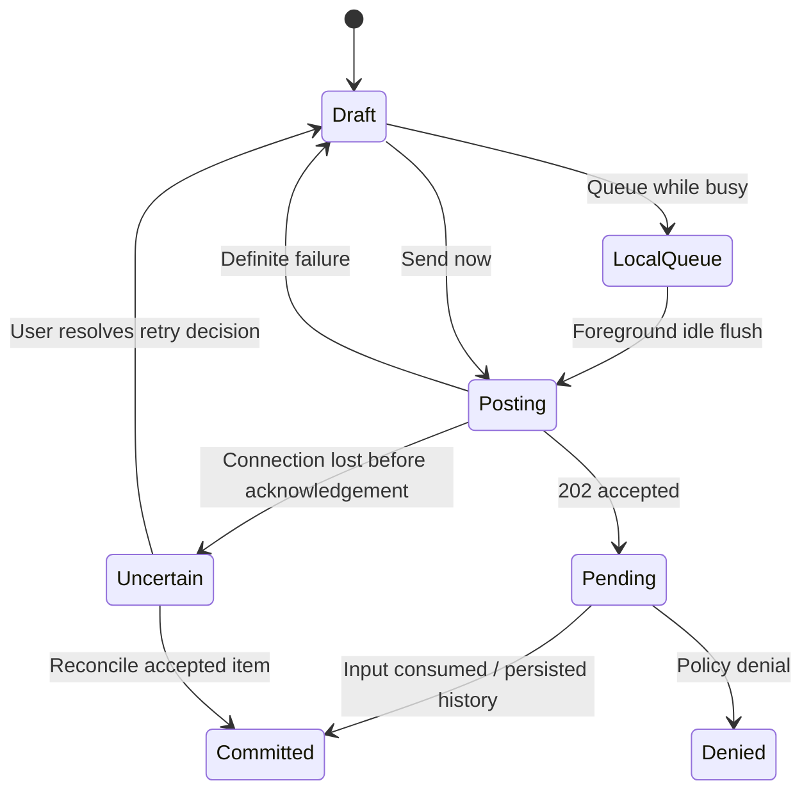

# Server contracts for a mostly native iOS client

Baseline: commit `76281b94`, inspected 2026-10-16. All contract findings are
**source-only**; this specialist audit ran no live server operations and no tests. Paths
and line numbers below refer to this revision. The proposed scope follows
[`mobile-scope.md`](mobile-scope.md): native connection management, session
monitoring/search, conversation reading/sending/stopping, approvals/questions,
and basic creation using configured hosts. Attachments and artifact previews
are separable extensions. Terminal rendering is optional.

The server already exposes most of the required behavior. The largest risks
are replacing deployment-owned authentication/URL routing and reproducing the
history/live-stream reconciliation currently implemented in JavaScript.
Generating a client from OpenAPI alone is insufficient: message submission and
elicitation routes are deliberately omitted from that schema.

## Connection, authentication, and deployment contract

| Deployment | Verified contract | Native feasibility and remaining evidence |
| --- | --- | --- |
| Explicit local single-user server | Header auth falls back to `local` only when the explicit single-user marker is set; missing identity otherwise fails closed. `/v1/info.single_user` distinguishes it from proxy auth. | Direct native HTTP/SSE/WS is structurally possible. Device reachability and native HTTP transport policy require Mac/device validation. Do not equate `accounts_enabled=false` with unauthenticated access. |
| Standalone accounts | `POST /auth/login` with username/password returns `token`, `expires_in`, `user` and sets a cookie. The JWT also authenticates HTTP and WS as `Authorization: Bearer ...`. | Native login can use the existing response. Store credentials per server securely; account setup/invite management can hand off to the browser. Ordinary session tokens have expiry but no refresh endpoint in this login contract; reauthentication is required. `/auth/logout` clears the browser cookie; native logout must also delete its stored token. |
| Standalone OIDC | `POST /auth/cli-login` returns a ticket and relative browser login URL. Browser completes the server's OIDC flow; `GET /auth/cli-poll?ticket=...` returns 202 pending, 200 token/user/expiry, or 410 expired. | Existing flow is a candidate for browser-mediated native login without copying browser cookies. Verify browser completion UX, ticket expiry/restart, ingress routing, and token expiry on device. Tickets are held in the router's memory, so multi-replica/restart behavior needs deployment evidence. |
| Header/proxy or embedded workspace | Trusted upstream identity headers authenticate the server. Embedded web receives a host `fetcher` and WebSocket URL resolver responsible for real API paths and authentication. | **External integration evidence gap**, not a demonstrated server defect. Native bootstrap, credentials, workspace identity, HTTP/SSE/WS routing, and renewal need the embedding owner's contract. The browser's current success does not prove `URLSession` can use the same login. |
| Accounts device grant | Mounted only with `OMNIGENT_DEVICE_GRANT_ENABLED`, accounts mode, and a permission store. May additionally require `X-Omnigent-Client-Secret`. Access tokens last one hour; rotating refresh tokens are bounded by a 30-day grant lifetime. | Optional specialized flow, not the default mobile solution. A distributed phone app cannot treat a bundled server secret as confidential. Delegated path scope permits sessions/agents/hosts/runners, but excludes authenticated `/v1/me`, `/v1/harnesses`, and `/v1/projects`. Reusing the web bootstrap would fail. |

Evidence: `omnigent/server/auth.py:7`, `:52`, `:471`, `:521`, `:597`;
`omnigent/server/routes/accounts_auth.py:244`, `:307`, `:323`;
`omnigent/server/routes/auth.py:484`; `omnigent/server/app.py:2769`;
`omnigent/server/routes/device_auth.py:67`, `:83`, `:615`.
`tests/server/test_accounts.py:334` and `tests/server/test_oidc.py:617` cover
bearer acceptance. `tests/server/test_device_auth.py:288`, `:452`, `:499`
cover delegated scope, default-off routes, and the optional secret gate.

`GET /v1/info` is intentionally unauthenticated at the Omnigent layer. It
reports accounts/login/setup state, server version, sharing policy, managed
sandbox availability, harness installation and dictation flags. It does **not**
advertise an API compatibility version, API/WS base URLs, or device-grant
availability. An upstream proxy may still protect it. `GET /v1/me` reports
identity/admin state; accounts/OIDC missing credentials produce 401 with
`login_url`. Header mode can return 200 with `user_id:null`, so HTTP success
alone does not establish authentication (`app.py:2065`, `:2192`, `:2209`).

The existing web capability probe caches a permissive/fallback sentinel after
failure (`web/src/lib/capabilities.ts:131`, `:163`). A native connection setup
should distinguish unreachable, unauthenticated, unsupported, and ready states
rather than treating failed discovery as a successful no-login connection.

**Separate the UI URL from API and WebSocket URLs.** Swift's
`WorkspaceURLExpander.swift:3` expands bare workspace origins to
`/ml/omnigents` after a HEAD probe; it excludes Databricks Apps hosts. This only
finds the UI. `web/src/lib/host.ts:27` separately documents an injected API
fetcher (example `/ajax-api/2.0/omnigent`), WS resolver, share-link transformer,
and CLI URL suffix. These examples are not a verified external mobile API
contract. A generic “append `/v1` to the saved UI URL” implementation is wrong.
Preserve server identity, workspace context, and mount paths independently.

Native URLSession requests can provide bearer headers on REST, SSE, and WS;
server auth accepts `HTTPConnection`, which includes WS handshakes
(`auth.py:471`). The origin policy accepts absent Origin for non-browser
clients (`omnigent/server/ws_origin.py:129`). Actual ingress handling of
headers/redirects/streaming remains to be tested. Do not port the web client's
`X-Forwarded-Email` injection as an authentication strategy: header mode's
identity trust belongs to the upstream proxy.

**Native network-policy migration:** `web/ios/Omnigent/Info-Debug.plist:38`
enables `NSAllowsArbitraryLoadsInWebContent`, a web-content exception. This
does not establish equivalent HTTP access for the proposed URLSession client.
Review local-server support and ATS configuration in both build variants, then
test on a Mac/device. No native ATS failure was reproduced during this audit.

## Core endpoint and ownership map

All paths below are logical server paths; a deployment transport maps them to
real URLs. Permission levels are read=1, edit=2, manage=3, owner=4. An absent
permission field on an older/auth-disabled response is not a grant of owner
capability.

| Journey | Web caller → server handler | Wire behavior and native obligation |
| --- | --- | --- |
| List/search sessions | `web/src/hooks/useConversations.ts` → `routes/sessions/routes_core.py:741` | `GET /v1/sessions`: cursor `after`/`before`, limit 1–1000 (default 20), `order`, `sort_by=created_at|updated_at`, `search_query`, `include_archived`, `kind`, `project`, `pinned`. Search covers title and item text. Default kind excludes children. Response has `data`, `first_id`, `last_id`, `has_more`; keep pagination/filter membership coherent while updates arrive. |
| Attention list | `web/src/pages/InboxPage.tsx:67` → list + snapshots | Current UI scans all session pages, selects nonarchived sessions with pending counts, then loads one snapshot per matching session. A first-page-only implementation silently misses requests. There is no pending-only list filter in the inspected handler. Root counts can include descendants; approvals must still target the originating child. |
| Read session | `sessionsApi.ts:735`, `:767` → `routes_core.py:629` | `GET /sessions/{id}` returns metadata, status, pending elicitations/inputs, active response, permissions, model/skills, host information. Optional `include_items=false`, `include_liveness=false`, `refresh_state=true`. Older servers may ignore optional query parameters. Include liveness unless another selected contract provides it. |
| Read history | `sessionsApi.ts:803` → `routes_items.py:58` | `GET /sessions/{id}/items?order=desc&limit=20`; next older page uses `after=<oldest-loaded-id>`. Reverse each descending page for chronological display. Server default is ascending and limit 100, so specify both. Cursor order follows stored item position, not timestamps. |
| Watch conversation | `sessionsApi.ts:942`, `chatStore.ts:2300` → `routes_events.py:1279` | `GET /sessions/{id}/stream` returns authenticated SSE, not a history replay. Optional `idle=true` changes presence. Read permission required. Open stream first, hydrate snapshot/history concurrently, merge by identity. |
| Send/steer | `sessionsApi.ts:904`, `chatStore.ts` → `routes_events.py:117` | `POST /sessions/{id}/events` with `type:"message"`, `data:{role:"user",content:[{type:"input_text",text:...}]}`. Edit required. 202 carries `queued`, optionally `item_id`, `pending_id`, or `denied`; acceptance is distinct from execution/consumption. |
| Interrupt/stop | `sessionsApi.ts:960`, `:971` → `routes_events.py:135` | `type:"interrupt",data:{}` cancels a turn. `type:"stop_session"` is a separate owner-only process termination; it preserves history and is non-sticky, so a later message can relaunch. Keep these user intents distinct. |
| Answer approval/question | `chatStore.ts:1653`, `sessionsApi.ts:988` → `routes_elicitations.py:62` | `POST /sessions/{target}/elicitations/{eid}/resolve`, body `{action:"accept"|"decline"|"cancel",content?:...}`; edit required. Use `target_session_id` when a child's card is mirrored in a parent. Returns 202 `{queued:false}`. |
| Basic create | `web/src/shell/NewChatDialog.tsx:2964` → `routes_core.py:158` | `POST /v1/sessions` JSON binds a durable `agent_id`; external host creation supplies `host_id` and absolute `workspace`. Preserve necessary wrapper labels/defaults. Response is a session snapshot. Create first, open its stream, then send the initial prompt. |
| Discover launch choices | `useHosts.ts:30`, new-chat hooks → `routes/hosts.py:558`, `routes/harnesses.py:18`, agents routes | Hosts list is caller-owned, includes online/offline state and `configured_harnesses`. Harness catalog is plugin-owned metadata, not proof a given host is ready. Model lists can arrive asynchronously via snapshot/catalog-ready events. Use already configured choices for the first mobile flow. |

`SessionResponse` is at `omnigent/server/schemas.py:1577`, session list models
at `:2170`/`:2304`, input at `:1132`, and create request at `:1222`.
Session snapshot items may be nested `{id,type,...,data:{...}}`; paginated
items are flattened by `to_api_dict()` (`routes_items.py:106`). Web explicitly
normalizes this difference (`sessionsApi.ts:873`). Prefer the paginated item
contract for native history and test both shapes if supporting full snapshots.

Basic creation depends on a host with credentials/harness support and a valid
workspace. Absolute workspace validation is server-owned; tilde/relative paths
are rejected (`schemas.py:1262`). A bare agent-bound create with no host/runner
does not guarantee execution readiness. Managed sandbox creation is a separate
capability-gated path with asynchronous provisioning and progress/error state;
it can be deferred without blocking ordinary connected-host creation.

## Streaming, recovery, and state transitions

```mermaid
sequenceDiagram
    participant N as Native session store
    participant S as Omnigent server
    N->>S: Start GET session stream
    par Live connection
        S-->>N: Ready heartbeat, in-flight text, resource state, live events
    and Hydration
        N->>S: GET session snapshot + latest item page
        S-->>N: Status, pending decisions, active response, committed items
    end
    N->>N: Merge item IDs; correlate text and elicitation IDs
    N->>S: POST message after subscription readiness
    S-->>N: 202 accepted; consumed/status/delta/commit events
    Note over N,S: On transport drop, reconnect and repeat reconciliation
```

Verified behavior and implications:

- **No durable event cursor.** `omnigent/runtime/session_stream.py:81` adds no
  sequence number. Each subscriber has a bounded ephemeral queue (1024 events);
  overflow closes transport so the client recovers from persisted state. Do
  not assume `Last-Event-ID` can replay a disconnect gap.
- **There is limited snapshot replay.** Contrary to older “no replay” comments,
  `_stream_live_events` supplies a ready heartbeat and a synchronous in-flight
  assistant-text snapshot before resource snapshots/live tail
  (`routes/_sessions/helpers.py:6815`). `runtime/inflight_text.py` owns this
  state. This is not a complete event log: tools/reasoning/control edges can
  require persisted history and session state reconciliation.
- **Initial open is stream first, snapshot concurrently.** Web deliberately
  does not block history/approval hydration on delayed stream headers
  (`chatStore.ts:2289`). For an immediate first send, subscription readiness
  matters; a server ready heartbeat exists for that purpose. If initial stream
  establishment is delayed or fails while snapshot succeeds, reconcile again
  once it connects rather than treating that snapshot as current indefinitely.
- **History is bounded, not truncated.** Web starts with 20 items and may page
  up to eight windows to include two user prompts (`sessionsApi.ts:252`,
  `:826`, `:854`). Older pages remain available. A native client may use a
  different initial window but must preserve scroll-back and stable ordering.
- **Deduplicate at every commit boundary.** Item IDs identify persisted
  history; elicitation IDs identify decisions; streamed assistant text also
  needs message/response correlation before its final persisted item arrives.
  Recheck IDs when a buffered stream batch lands after snapshot merging
  (`chatStore.ts:3331`, `:3591`, `:3668`). Keep session/server identity and a
  generation token on asynchronous work so switched-away results cannot update
  the new screen (`chatStore.ts:535`, `:1831`).
- **Reconnect repairs state, not only text.** Web drops ephemeral in-flight
  blocks, pumps the new stream, reloads metadata and newest items, pages back
  to overlap (up to four pages), then rehydrates a bounded window if necessary.
  It reconciles status, `active_response_id`, pending decisions, and usage
  (`chatStore.ts:2662`, `:2720`, `:2954`, `:3221`). A missed completed turn must
  clear the spinner; a still-running turn must regain its streaming state.
- **Completion and disconnection differ.** `data: [DONE]` is intentional stream
  completion; EOF/error without it is reconnectable. The server emits idle
  heartbeats every 15 seconds. Web retries healthy transport drops immediately,
  failed opens with jittered 250 ms–5 s backoff, stops on 401/403, and bounds
  repeated 404 retries (`chatStore.ts:740`, `:3148`; `sse.ts:72`). Decide native
  foreground restoration explicitly even if a prior connection ended cleanly.

Server snapshot/list status is `idle`, `running`, `waiting`, or `failed`;
`session.status` SSE additionally permits `launching`. Interruption is its own
event, and response lifecycle events are a separate vocabulary.
`waiting` can mean background work still running after the foreground turn
settled. Host/runner availability is also separate from turn status; resumable
managed hosts differ from unavailable local hosts. Avoid one boolean “running”
that loses these distinctions. See `schemas.py:2520`,
`chatStore.ts:2722`, and `sessionsApi.ts:104`.



This is a proposed native state model grounded in current contracts. The web
queue is **client-held**, including messages for other sessions; its flush
uses sidebar state and a serialized send chain (`chatStore.ts:1043`). A native
foreground queue is feasible. Guaranteed delivery while iOS is suspended is
not provided by this server contract. Keep unsent drafts/queue entries distinct
from accepted server pending input. The web wire type explicitly notes that
`queued_items` appears in API documentation but is absent from the current
`SessionResponse` (`sessionsApi.ts:140`); it is not a durable queue contract.

There is no client request ID or idempotency field in `SessionEventInput`, and
no idempotency handling was found on the inspected create/message routes.
Therefore an ambiguous POST failure cannot safely be retried automatically
with an exactly-once promise. Native wrapper messages can return `pending_id`
before transcript persistence; ordinary messages use `item_id` and
`session.input.consumed`. Policy-denied sends return `denied:true` without
persisting the user's input; the denial explanation itself is persisted
(`tests/server/routes/test_sessions_input_policy_deny.py:66`).

## Decisions and attention recovery

`ElicitationResult.content` is a flat map with scalar/string-list values
(`schemas.py:1101`). Question IDs/text map directly to chosen answers, not a
nested `answers` object. Retain request schema, command/plan preview, external
URL, and target-session fields from SSE/snapshot even if advanced “remember”
controls are deferred (`web/src/lib/sse.ts:841`,
`web/src/components/blocks/ApprovalCard.tsx:189`).

Full cards should use `pending_elicitations` from the session snapshot or
`response.elicitation_request`; individual
`GET /sessions/{id}/elicitations/{eid}` returns only status/message/phase/policy
name/content preview, without the full question schema
(`routes_elicitations.py:129`). A deep link to a question therefore needs a
session hydration step or an expanded individual resource response.

The dedicated resolve route requires **edit**, not owner-only permission
(`routes_elicitations.py:111`); older client comments saying owner-gated are
imprecise. Resolution updates the server-held future where applicable, emits
resolved signals to the owning session and ancestors, and forwards to the
runner (`routes/_sessions/orchestration.py:1323`). A parent-visible child card
must post to `target_session_id` (`chatStore.ts:1653`). On foreground/reconnect,
merge pending IDs and retire cards absent from the new snapshot while avoiding
overwriting newer live events. Never automatically reapprove after a retry or
restore a saved card as authoritative pending state.

Elicitation indexing and several live-state caches are process-held; snapshot
recovery is not evidence of durable decision history across server restarts.
Test reconnect, server restart, runner re-registration, and resolution on a
second client separately (`runtime/pending_elicitations.py`,
`server/_elicitation_registry.py`).

## Session-list WebSocket

`WS /v1/sessions/updates` authenticates at handshake and access-checks each
watched session. Send `{"type":"watch","session_ids":[...]}` on connect and
when the set changes; it replaces the previous set. Replies are `snapshot`,
`changed` (full rows), `removed`, `hosts_changed`, and `heartbeat`.
Full WS rows carry explicit nulls to clear stale fields, unlike some REST
responses (`routes_core.py:1059`, `SessionUpdatesProvider.tsx:58`).

The watch set is capped at 500. Unknown IDs are not a complete discovery
mechanism: live session-added announcements can push new accessible sessions,
but announcements during disconnect are not replayed. Re-fetch lists on
reconnect/foreground and maintain periodic reconciliation. Server idle
heartbeats are 30 seconds; the web silence watchdog reconnects at 70 seconds
(`routes/_sessions/common.py:419`, `routes_core.py:1194`, `:1252`,
`runtime/user_session_stream.py:3`, `sessionUpdatesSocket.ts:38`).

This channel can be deferred in a first internal slice in favor of explicit
REST refresh/polling, but eventual native monitoring should preserve its
freshness and fallback semantics. It does not replace the active session's
SSE stream or provide background push notifications.

## Optional attachments, previews, and terminal

- **Attachments:** `POST /sessions/{id}/resources/files`, multipart `file`,
  requires edit permission and configured stores. It returns a resource ID;
  message submission references that file ID in a second request. Keep a
  successful upload ID when retrying the message to avoid duplicate blobs.
  Current supported types are images/PDF/text-code, capped at 5/20/10 MiB
  respectively (global cap 25 MiB); unsupported type is 415, over-limit 413,
  missing stores 501 (`routes_resources.py:891`,
  `omnigent/runtime/content_resolver.py:103`, `web/src/lib/filesApi.ts:10`).
- **Read-only artifacts:** file metadata/content endpoints require read
  permission and are session-scoped. Content responds with attachment
  disposition and `nosniff`; native download/Quick Look can consume bytes
  without a general embedded browser (`routes_resources.py:1018`). Workspace
  filesystem browsing is a separate runner/host-backed contract and is not
  necessary to support uploaded artifacts.
- **Terminal:** `/sessions/{id}/resources/terminals/{tid}/attach` is WS with
  binary PTY bytes in both directions and JSON resize controls
  (`web/src/components/blocks/TerminalSession.ts:7`, `:608`,
  `omnigent/server/routes/terminal_attach.py`). Authentication, terminal
  availability, reconnect/close-code handling, sizing, and renderer lifecycle
  remain additional work. Native CLI wrapper chat is not automatically
  terminal-only: wrapper input and approvals are transported through session
  APIs. Deferring terminal does not mean omitting all native-wrapper sessions.

## Concrete gaps and implementation boundaries

| Priority | Finding | Required response |
| --- | --- | --- |
| P0 | Workspace/proxy native login and API/WS routing are owned outside the inspected repo. | Obtain and verify that integration contract before promising workspace support. This is an evidence dependency, not a proven backend bug. |
| P0 | Core messages/elicitation routes are `include_in_schema=False`; generic event payloads and WS are not a complete generated client surface. | Maintain explicit native wire types/fixtures for the selected endpoints, or publish a supported client schema. Do not claim generated-code completeness. |
| P0 | Recovery spans history, transient text, pending inputs, approvals, and status; no durable replay cursor. | Implement a native session state reducer and reconnect reconciliation with recorded fixtures. A replay-log server rewrite is not required for an initial supported client. |
| P1 | No advertised compatibility/capability contract for independently released clients. Package `server_version` alone is insufficient for internal builds or per-feature additions. | Define a supported server floor and contract tests; consider explicit API capabilities/minimum client version before broad release. Preserve unknown event/item values without crashing. |
| P1 | Ambiguous create/send retries have no idempotency contract. | First release must expose uncertain sends and reconcile before user retry. If reliable automatic retries/background outbox are required, add server idempotency and delivery-status semantics. |
| P1 | Attention inventory requires scanning all sessions; full individual elicitation schema is unavailable. | Existing list+snapshot approach works at bounded scale. A pending-elicitation query with complete typed resources would reduce mobile fan-out and simplify deep links; optional server improvement unless scale demands it. |
| P1 | Device grant discovery/scope is insufficient for universal native bootstrap. | Use verified mode-specific accounts/OIDC flows; if device grant is chosen, add advertised capability and intentionally designed scope rather than silently broadening permissions. |
| P1 | Queued sends and notifications currently depend on a live foreground client. | Scope queue guarantees to foreground and drafts to local persistence. Durable scheduling/APNs require separately designed server features. |
| P2 | Error shapes vary: session `error:{code,message}`, host `detail`, login `error:string`, OAuth `error` strings, and proxy HTML. | Decode each deliberately, expose actionable offline/auth/permission/unsupported states, and never parse an HTML login response as successful API data. |

## Reproducible validation handoff

The coordinator ran 527 existing web unit tests across ten files, including
all five web files listed below; all passed. These tests use mocks and do not
prove native transport or live deployment compatibility. See
[`validation-baseline.md`](validation-baseline.md) for the recorded commands
and results. The backend checks below are suggested and **unexecuted** in this
discovery pass. Run from the repository root after installing the contributor
dependencies:

```sh
uv run pytest -q tests/server/test_accounts.py tests/server/test_oidc.py \
  tests/server/test_device_auth.py tests/server/test_ws_origin.py \
  tests/server/routes/test_auth_routes.py

uv run pytest -q tests/server/routes/test_sessions_crud.py \
  tests/server/routes/test_sessions_snapshot.py \
  tests/server/routes/test_session_updates_ws.py \
  tests/server/routes/test_stream_live_events.py \
  tests/server/test_stream_events.py tests/runtime/test_session_stream.py \
  tests/runtime/test_inflight_text.py tests/runtime/test_pending_elicitations.py \
  tests/server/integration/test_sessions_elicitation_resolve_url.py \
  tests/server/routes/test_sessions_input_policy_deny.py

npm --prefix web test -- src/lib/sessionsApi.test.ts src/lib/sse.test.ts \
  src/store/chatStore.test.ts src/lib/sessionUpdatesSocket.test.ts \
  src/hooks/SessionUpdatesProvider.test.tsx
```

For the optional file extension:

```sh
uv run pytest -q tests/server/routes/test_sessions_upload_limits.py \
  tests/server/routes/test_session_resources.py
```

Useful existing assertions include snapshot chronological ordering
(`test_sessions_snapshot.py:185`), explicit null clears and watch caps
(`test_session_updates_ws.py:320`, `:434`), discovery authorization (`:518`,
`:553`), stream overflow without `[DONE]` (`test_stream_events.py:470`), and
native in-flight text/pending elicitation recovery in the runtime suites.

Next contract fixtures should record: first open with history/live overlap;
mid-turn reconnect; a turn completing during a gap; approval arriving and
resolving during suspension; mirrored child questions; duplicate text prompts;
image-only pending input; unknown SSE/item variants; no-overlap history
backfill; slow/failed host launch; and an ambiguous POST acknowledgement.
Assertions should compare final transcript identities/order, pending decision
sets, status, and number of submitted messages—not just rendered snapshots.

On a named Mac/device and each supported deployment, verify connection
discovery → login → paginated list → running conversation → decision → relaunch.
Record UI/API/WS base mapping, auth mode, credential expiry behavior, package
version and native build, background/network transitions, and whether a
proxy recycles streams. Obtain the workspace transport contract before running
that deployment-specific check; do not infer credentials from the web view.

## Unanswered decisions

1. Which workspace/proxy integration provides supported mobile credentials and
   API/WS URL discovery? Both standalone and workspace remain planning scope
   pending the coordinator's deployment decision.
2. Which server release floor and harness subset can the independently shipped
   native app support? Model/approval availability cannot be inferred solely
   from a harness display name.
3. Is a foreground-only queue sufficient? Any stronger delivery guarantee
   changes the server work required.
4. Must attention discovery scale beyond scanning all sessions, and must
   decision details survive server restarts?
5. Are attachments included in the first slice or a follow-up, and is any
   terminal renderer exception worth its added lifecycle/protocol cost?
